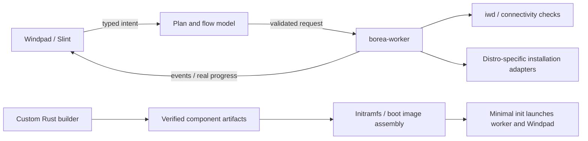

# Borea system architecture

Design only, 2026-11-06. No builder, initramfs, native UI, worker, image, or hardware
support has been implemented or benchmarked. The present task is documentation
only. [Open decisions](DECISIONS.md) must remain distinguishable from agreements.

## Agreed direction

- An independent live environment: no distro base or distro package repository
  used to populate the live filesystem. The installed target may be Arch, Debian,
  Fedora, openSUSE, or a supported flavour and uses its own supported sources.
- Fully custom build orchestration in Rust; **not Buildroot**. Proposed developer
  interface is `cargo xtask`, with no command implemented yet.
- Kernel, Mesa, iwd and buildable firmware components sourced from pinned upstream
  inputs; minimal init launches Windpad from the initramfs.
- GitHub Actions may build components and publish caches as releases in
  `BoreaProj/borea`. An optional local full-source rebuild must remain possible.
  This agreement does not establish available credentials, quota, or push access.
- Target ≤120 seconds for the warm, cached ISO-assembly path. No two-minute promise
  for a clean toolchain/kernel/Mesa build or for uncached network transfers.
- Initial graphics targets: Arc A770, RX 6700 XT, RTX 3060, Intel and AMD integrated
  graphics, and software rendering fallback. First real machine: the user's RTX
  4050 laptop, integrated path first, NVIDIA path second. These are targets, not
  claims of current compatibility.

Firmware qualification: many GPUs and Wi-Fi devices require vendor-distributed
binary firmware with no corresponding buildable source. “All firmware built from
source” cannot be promised for this hardware. Record each blob, license, hash and
redistribution permission; obtain a policy decision before including it. Open
kernel/userspace drivers do not imply source-available device firmware.

## Proposed workspace boundaries (not created)

```text
crates/windpad/       Slint UI, navigation, localized presentation
crates/borea-core/    typed plan, compatibility rules, event/state model
crates/borea-worker/  hardware/network adapters and privileged install execution
crates/borea-init/    only if a custom Rust init is chosen
xtask/               build graph, source verification, cache and image assembly
ui/                  shared Slint tokens/components and flow pages
components/          pinned source manifests, recipes, configs and license records
image/               initramfs layout and boot configuration inputs
design/flow/         locked contract and immutable HTML references
```

Use the existing checkout in isolated cloud tasks; do not create worktrees unless
requested. Do not choose a Rust target, libc, Slint backend, or static linking
strategy until the decisions and required graphics/network libraries are known.



Keep slow probing, package resolution, downloads, compression, and installation
off the UI thread. Readiness is an event from initialized services; animation
completion is never the readiness source. A process boundary and explicit local
protocol should separate presentation from privileged operations. Validate every
request against the current plan; do not accept arbitrary shell command strings
from the UI. Exact IPC and privilege model are still to be designed.

## Custom source builder and cache contract

Proposed commands and meanings:

| Command | Intended contract |
| --- | --- |
| `cargo xtask components` | Build selected components from verified upstream source; slow, incremental |
| `cargo xtask components --rebuild-all` | Explicit local full-source build with caches bypassed for outputs, preserving source verification |
| `cargo xtask iso` | Resolve exact cached components, verify, build changed Borea binaries if needed, assemble and validate image |
| `cargo xtask iso --offline` | Use local verified artifacts only; fail clearly on missing inputs |

These names describe interfaces to implement later, not runnable instructions.
Missing cache artifacts must produce an actionable slow-path/cache-fetch report;
never silently start a full source rebuild while reporting a fast assembly run.

Each component manifest needs an upstream version/revision, source URLs and
cryptographic digests, recipe revision, patches, full config, target triple/ABI,
compiler/linker versions, dependency fingerprints, and licensing metadata. The
cache key covers all of these plus relevant environment/feature flags. A version
name alone is not a cache key. Pin toolchain and host build prerequisites as well
as runtime inputs; a custom builder still needs upstream build tools.

Actions build jobs should publish immutable, content-addressed outputs plus
checksums and provenance tied to a trusted source commit. Cache consumers verify
against a trusted manifest or signature, not a hash downloaded from an unrelated
or untrusted release. Do not execute an artifact just because a release name
matches. Define signing/trust and protected publication credentials before adding
the workflow; no credentials go into the repository or design files.

Build components in isolated staging prefixes and assemble from explicit output
manifests. Keep host distro packages out of the live root. Audit transitive shared
libraries, dynamic loader, graphics drivers, firmware and licenses. Rust binaries
are not automatically static; Slint, Mesa and a chosen libc affect the closure.
Host development on a distro is compatible with an independent live image.

Pin inputs and control build timestamps, file ordering, paths and compression
settings. Cacheability alone does not prove bit-for-bit reproducibility: compare
two clean builds before making that claim. Record an SBOM and component inventory.

### Two-minute budget and measurement

Define the warm case as: verified component outputs already on local storage,
host tools ready, and Borea binary build state explicitly reported. Measure wall
time from command start through verified final ISO output; report source/cache
verification, changed application compilation, staging, compression, boot assembly
and validation separately. State CPU, RAM, storage and compression configuration.

Measure warm no-change assembly, a UI-change rebuild, a cold cache download and a
full-source build separately. The ≤120 s goal applies to the first case; whether
UI-change builds also fit is to be measured. Network fetch time is visible even
when excluded from the warm budget. An oversized or slow result is a failed budget,
not grounds to skip integrity checks. A sub-300 MB image is an initial aspiration
from the discussion, not an established size requirement or measured result.

First build one bootable x86-64 image with a defined boot mode, initramfs format,
bootloader and graphics closure. Those details are not yet selected. Do not claim
ISO creation works until it boots and reaches a functional UI. Heavy builds need
explicit concurrency and memory caps; reuse unchanged outputs, not stale outputs
whose fingerprints differ.

## Live runtime and installation

The accepted Omarchy implementation baseline, including trim, plan semantics
and end-to-end acceptance checks, is [OMARCHY.md](../../design/flow/OMARCHY.md).
Use it with the locked visual language; it does not establish an existing
upstream integration or working backend.

Minimal init mounts required virtual filesystems, discovers/loads hardware support,
starts required device/network services, and launches the worker and Windpad. It
must reap children, handle shutdown and surface failure/recovery when the UI cannot
start. A custom Rust init versus s6/dinit remains open. Choose display/input/session
integration with the Slint backend; do not assume Slint provides a compositor or
that a direct DRM backend can share display ownership without design work.

Network operations use iwd plus explicitly selected address configuration, DNS
and connectivity-probe support. iwd alone does not settle every service choice.
Network state must distinguish link, authentication, address assignment, captive
portal and usable internet. Choose a probe endpoint/privacy policy and portal
browser strategy before implementing the online gate.

Resolve an install plan before Review: family/flavour, packages/customization,
target disk identity and layout, encryption/snapshots, account and locale settings.
Changing upstream choices invalidates dependent choices and recomputes the summary.
The privileged worker rechecks disk identity and preconditions before any write.
Explicit final confirmation authorizes the displayed destructive plan. Credentials
stay out of logs and saved summaries. Report truthful phases and errors; never
show a fabricated percentage as measured progress. Cancellation semantics must
distinguish preparation from destructive operations; no universal rollback promise.

Use distro-specific supported installation adapters. In particular, Bazzite's
image-based deployment and Omarchy's installer cannot be assumed to behave like
a normal package-selection install. Omarchy handoff, post-install removal and
update persistence need a supported unattended integration or an explicit design
revision. No handoff may bypass Borea's final review contract.

## Graphics and resource policy

Use the GPU that drives the selected screen by default. Determine DRM connector
and device ownership instead of assuming PCI device zero or always selecting the
fastest GPU. Hybrid graphics, render offload, MUX switching and external ports can
change which device owns a connector; the RTX 4050 laptop topology is unknown.

| Target | Candidate open stack to investigate | Evidence needed |
| --- | --- | --- |
| Intel Arc A770 / Intel iGPU | Appropriate kernel DRM driver for generation, Mesa Intel drivers | Modeset, firmware, rendering, input and boot |
| AMD RX 6700 XT / AMD iGPU | amdgpu, RADV; radeonsi if OpenGL is retained | Same, with selected UI backend/API |
| NVIDIA RTX 3060 / RTX 4050 | nouveau + Mesa NVK, subject to hardware/firmware requirements | Kernel/firmware compatibility, power management and native UI |
| Software fallback | Selected Slint CPU renderer; required display path still needed | Usable UI without hardware rendering |

“Open drivers” is the agreed direction. NVIDIA's open kernel modules are not by
themselves an entirely open userspace stack. Select and validate exact upstream
versions later. Intel/AMD integrated graphics cover multiple generations; define
a supported generation range from tested machines rather than claiming all CPUs.

Dropping AMD OpenGL to avoid LLVM is an **open question**, not an adopted change.
RADV, software Vulkan and other enabled Mesa features can also affect LLVM needs.
Verify the complete feature/dependency closure. Keep software fallback available;
prefer investigating Slint's CPU renderer over silently assuming llvmpipe can be
removed without replacement. Firmware redistribution remains a separate issue.

Define a user-visible GPU override and persist it only with consent; its exact
location (boot option, recovery/settings page, or both) is open. Multi-monitor
selection/mirroring and hotplug/focus behavior are also open. Never guess that
the laptop internal display and every external connector share the same GPU.

Proposed RAM-tier behavior: reduce decorative wind/motion and worker concurrency
under pressure, cap caches, and bound buffering/download staging. Numeric tier
thresholds and minimum RAM await measurements; do not advertise an untested minimum.
Give UI/input normal responsive scheduling and lower worker build/compression/I/O
priority with bounded concurrency. Avoid real-time scheduling as a shortcut.
Measure frame latency during actual background work before selecting policy limits.

## Validation milestones

1. Native fixture-driven boot/network/family UI matches the HTML at fixed sizes,
   fonts and animation phases; all required failure states are exercisable.
2. Minimal image boots in a VM, initializes input/display/network, starts Windpad
   and worker, handles service failure, and shuts down cleanly. VM graphics do not
   establish physical GPU support.
3. RTX 4050 laptop integrated-GPU path, then NVIDIA path: record CPU, topology,
   firmware, versions, display routing, render device, logs and fallback behavior.
4. Validate the named desktop GPUs and representative Intel/AMD iGPUs, then
   multi-monitor/hotplug and resource-pressure behavior. Keep untested targets
   labelled untested.
5. Use disposable virtual disks for real whole-disk/alongside/manual installation
   tests, encryption, snapshots, failure/retry and final boot. Verify preserved OS
   data for alongside installs before exposing that capability to real users.
6. Measure cache integrity failures and all build timing cases; compare clean
   builds for reproducibility. Only then report speed, size and hardware coverage.

No installation, push, release publication, package download or source compilation
is needed to review this architecture. Documentation checks do not validate an ISO.
